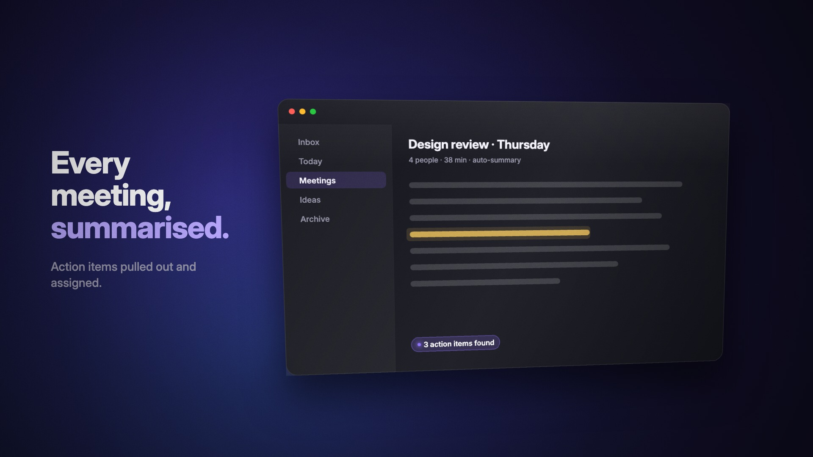
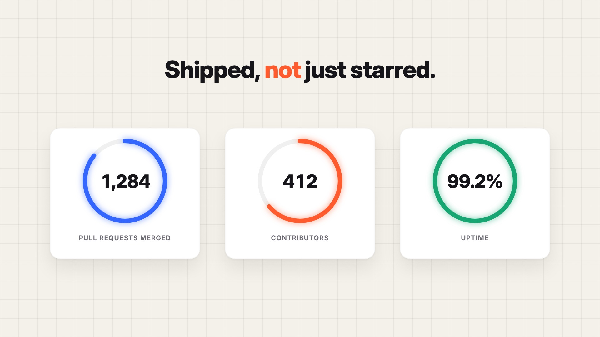
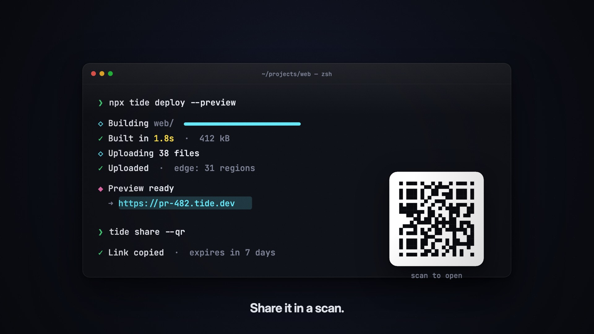
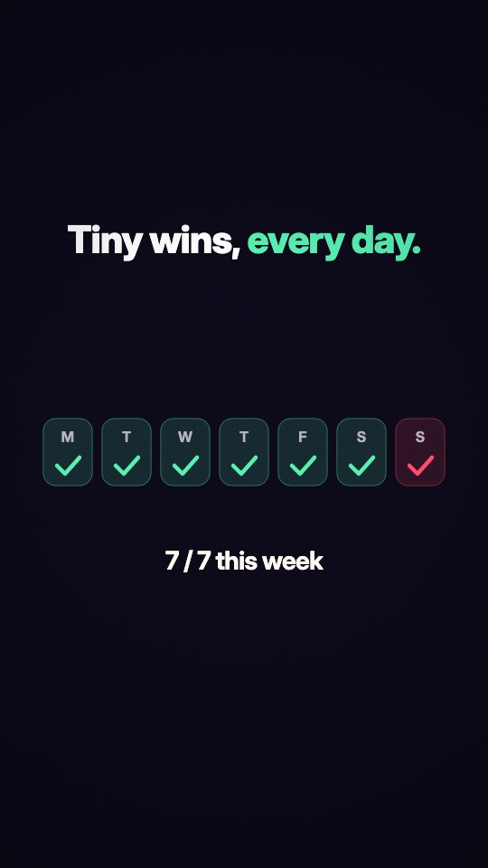

# reelkit

**Your coding agent can now make motion-graphics videos that don't look like AI slop.**

Write one HTML file with a small animation runtime. reelkit renders it deterministically, frame by frame, in headless Chromium and encodes an H.264 mp4. It ships with the motion-design pieces that make video look *designed* (spring physics, motion blur, rolling odometer numbers, word-by-word blur-in captions, kinetic type, camera moves, motion-blurred transitions) and a `SKILL.md` that teaches Claude Code / Codex the taste to use them well.


<table>
<tr>
<td></td>
<td></td>
</tr>
<tr>
<td></td>
<td align="center"></td>
</tr>
</table>

Every image above was rendered by reelkit from the files in [`examples/`](examples/) (the GIF is the first seconds of `launch.html`).

## 30-second quickstart

```bash
npm install github:thecidsama/reelkit   # not on npm: the `reelkit` npm package is a different project
npx reelkit doctor             # checks the browser + ffmpeg
npx reelkit new promo --template launch
npx reelkit preview promo/scene.html                         # live-reloading player
npx reelkit frames  promo/scene.html --sheet -o promo/sheet.png   # whole video on one image
npx reelkit render  promo/scene.html -o promo/promo.mp4
```

No system ffmpeg needed (it comes from `ffmpeg-static`). The browser is Playwright's Chromium; if it isn't cached, reelkit falls back to an installed Google Chrome, or tells you exactly what to install.

A whole scene:

```html
<!doctype html><html><head><meta charset="utf-8"></head><body>
<script type="module">
import { reel } from '/reelkit/reel.js';

reel({ width: 1920, height: 1080, fps: 60, background: '#0b0b10', grain: 0.05 })
  .scene('title', 3.2, s => {
    s.bg({ radial: ['#17142b', '#0b0b10'] });
    s.words('Make it *move.*', { x: s.cx, y: 580, size: 150, weight: 750, align: 'center', at: 0.3, accent: '#9b87ff', exit: 2.7 });
  })
  .scene('count', 3, s => {
    s.bg('#0b0b10');
    s.odometer(12480, { x: s.cx, y: 590, size: 220, weight: 700, align: 'center', at: 0.3, dur: 1.8 });
  }, { transition: 'whip' })
  .start();
</script></body></html>
```

## Use it from Claude Code / Codex

reelkit is built around an agent loop: **write the scene → render stills → look at them → fix → render the mp4**. `reelkit frames --sheet` puts the whole video on one image, so an agent can review every beat with a single image read, and `--at stats+1.2` zooms into one moment by scene name.

Install the skill so your agent picks it up when you ask for a promo, launch video, product demo or animated explainer:

```bash
# Claude Code (personal skills)
mkdir -p ~/.claude/skills && cp -r node_modules/reelkit/skills/reelkit ~/.claude/skills/
# or per project
mkdir -p .claude/skills && cp -r node_modules/reelkit/skills/reelkit .claude/skills/

# Codex and other agents: point them at SKILL.md (e.g. reference it from AGENTS.md)
```

Then ask: *"Make a 15-second launch video for our v2 release, 1080p, with the three headline features."*

The skill ([`SKILL.md`](SKILL.md)) is deliberately short: the workflow, an API cheat sheet, and a taste section (timing and holds, easing choices, type scale, palette and contrast, safe areas, and a list of what makes motion look cheap).

## What's in the box

| | |
|---|---|
| **Runtime** (`runtime/reel.js`) | Zero-dependency ES module. Scenes + transitions (`fade`, `whip`, `zoom`, `wipe`, `iris`, `push`, `cut`), camera with handheld shake, analytic springs, 18 easings + cubic-bezier, keyframes, seeded RNG/noise, word-by-word blur-in / mask / pop captions, per-letter spring type, typewriter with cursor, odometer counters, highlighter sweeps, rotating words, cards with layered shadows, 2.5D perspective cards, particles and confetti, aurora/gradient/grid backgrounds, film grain, vignette, bar/line/ring charts, sub-frame motion blur. |
| **CLI** (`reelkit`) | `render` (parallel pages, in-order pipe into ffmpeg, progress + ETA, fails loudly on any page error), `frames` (stills, scene-name timestamps, contact sheets), `preview` (scrubber, frame stepping, live reload), `new` (templates), `doctor`. |
| **Examples** | `launch` (product announcement), `stats` (odometers, line/bar charts, rings), `terminal` (typed commands, camera that follows the typing), `vertical` (9:16 short). |
| **Fonts** | Inter, Archivo and JetBrains Mono, bundled (OFL), so text renders the same everywhere. |

Full reference: [docs/API.md](docs/API.md).

## How determinism works

- A frame is a pure function of time: `renderFrame(t)` draws the same pixels for the same `t`. The runtime has no wall clock, no unseeded randomness, and no state carried between frames; springs are solved analytically, typing rhythm and particles come from seeded hashes, grain is keyed to the frame number.
- Motion blur is computed, not faked: the runtime draws several sub-frames inside the shutter interval and averages them (transitions do the same on their two layers).
- Because frames are independent, `render` splits them across N browser pages and reassembles them in order before piping JPEG (or `--png`) frames to ffmpeg's stdin. No temp files.
- `npm test` checks this: the same `t` hashes to the same pixels in two separate browser sessions, and rendering out of order changes nothing.
- The render contract is tiny (`window.READY`, `END`, `FPS`, `renderFrame(t)`, a `<canvas id="c">`), so you can also render a hand-written canvas page without the runtime.

## How it compares

| | reelkit | HyperFrames (HeyGen) | Remotion | Motion Canvas |
|---|---|---|---|---|
| You write | One HTML file, Canvas 2D + reelkit helpers | HTML | React components | TypeScript generator functions |
| Rendering | Headless Chromium → ffmpeg (bundled) | See their docs | Headless Chromium → ffmpeg | Browser-based editor / renderer |
| Aimed at agents | Yes: SKILL.md, contact sheets, scene-name stills | Yes ("built for agents") | General purpose | General purpose |
| Motion-design helpers | Built in (springs, motion blur, odometer, kinetic type, transitions) | See their docs | Via React ecosystem / your own | Built in (tweens, signals, scene graph) |
| License | MIT | See their repo | Remotion license (free for individuals and small teams, paid company license above that) | MIT |

Pick Remotion if you want React and its ecosystem (and a mature, much larger project). Pick Motion Canvas if you want an interactive editor for explainer animations. Pick reelkit if you want an agent (or you) to produce a polished mp4 from one self-contained file with as little ceremony as possible.

## Limitations

- Canvas 2D only (no WebGL helpers, no DOM/CSS layout inside the video).
- Audio is muxed as given (`--audio`), not generated or synced to events for you.
- Rendering speed depends on the scene: the examples render at roughly 55–115 fps at 1080p on an Apple Silicon laptop with the default worker count; motion blur multiplies the cost by its sample count.
- Pixel-identical output is guaranteed on the same machine and Chromium revision; across platforms, anti-aliasing can differ slightly.

## Development

```bash
npm install
npm test                 # runtime unit tests + end-to-end render/frames tests
node bin/reelkit.js render examples/launch.html -o examples/out/launch.mp4
```

## License

MIT. Bundled fonts are under the SIL Open Font License (see `runtime/fonts/`).
